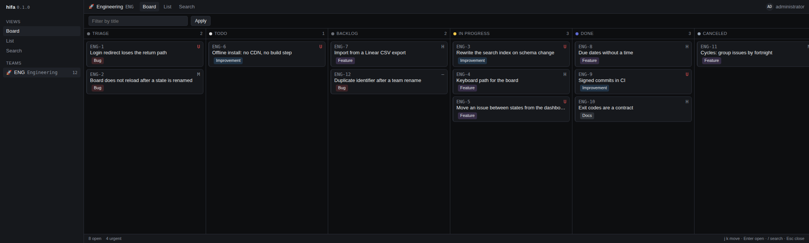

<p align="center">
  
</p>

<h1 align="center">hifa</h1>

<p align="center">
  <strong>A real issue tracker. Your machine. One SQLite file.</strong><br>
  A local issue tracker with a real CLI, a real database and a dashboard that loads in 40 ms.
</p>

<p align="center">
  <a href="https://github.com/ginkelte/hifa/actions/workflows/ci.yml"></a>
  <a href="https://github.com/ginkelte/hifa/actions/workflows/signatures.yml"></a>
  <a href="LICENSE"></a>
  
  
  
</p>

---

No sign-up. No sync engine. No Postgres. No Node build step. No telemetry. `hifa` is what you get
when you want a real issue tracker — teams, identifiers like `ENG-42`, semantic states, priorities,
labels, sub-issues, relations, history — without renting a service to hold your backlog.

```
$ hifa issue create "Fix the SSO login redirect" --team ENG -p high -l Bug --due 2026-11-15
IDENTIFIER  P  STATE  ASSIGNEE  TITLE                       LABELS  DUE
ENG-1       H  Todo   –         Fix the SSO login redirect  Bug     2026-11-15
```

## Contents

- [Why this instead of…](#why-this-instead-of)
- [Screenshot](#screenshot)
- [Install](#install)
- [Quickstart](#quickstart)
- [What you get](#what-you-get)
- [CLI surface](#cli-surface)
- [Teams and workflow states](#teams-and-workflow-states)
- [Dashboard](#dashboard)
- [How it is built](#how-it-is-built)
- [Design principles](#design-principles)
- [Specifications](#specifications)
- [Development](#development)
- [Contributing](#contributing)
- [Roadmap](#roadmap)
- [Meet Hifa](#meet-hifa)
- [Status](#status)
- [License](#license)

## Why this instead of…

| | **hifa** | hosted trackers | a text file |
|---|---|---|---|
| Where your data lives | a `.db` file you own | their cloud | your repo |
| Account required | no | yes | no |
| Works on a plane | yes | no | yes |
| Identifiers, states, history | yes | yes | no |
| Queryable by an agent | `--json` on every command | their API | grep |
| Backup | `cp hifa.db backup.db` | an export | `git` |
| Cost | 0 | per seat | 0 |

If you need SSO across five countries, a compliance audit trail and someone to call at 3 a.m.,
a hosted tracker is the right tool. If your backlog is *yours*, lives next to your code, and you
want to query it in a shell, this is that.

## Screenshot

<p align="center">
  
</p>

<p align="center"><em>Real output, demo data: <code>hifa serve</code> on the seeded workspace. Six states, drag-and-drop columns, keyboard-driven.</em></p>

## Install

```bash
# CLI only (typer + pydantic)
uv tool install git+https://github.com/ginkelte/hifa

# with the dashboard (adds fastapi + uvicorn + jinja2)
uv tool install "hifa[web] @ git+https://github.com/ginkelte/hifa"
```

Python 3.11 or newer. The core never imports FastAPI: the `[web]` extra is optional and P9 makes
sure the CLI keeps working with it uninstalled.

## Quickstart

```bash
hifa init --team-key ENG --team-name "Engineering"
hifa issue create "Fix the SSO login redirect" --team ENG -p high --due 2026-11-15 -l Bug -l Docs
hifa issue create "Wire the command palette" -q          # prints ENG-2
hifa serve                                              # http://127.0.0.1:7777/
```

`hifa init` creates the database and seeds a workspace, one team, its six workflow states, four
labels and your local member. It is idempotent, and it writes `.hifa.toml` next to the database:

```
$ hifa init --team-key ENG --team-name "Engineering"
initialized hifa at /tmp/demo/demo.db
  workspace  Demo (demo)
  team       ENG — Engineering 🚀
  states     Triage, Todo, Backlog, In Progress, Done, Canceled
  labels     Bug, Feature, Improvement, Docs
  member     administrator
  config     /tmp/demo/.hifa.toml (created)
```

Every command speaks three dialects: a human table, `--json` for agents, `-q` for scripts that only
want the identifier. `--json` prints the canonical entity, with nulls included so a consumer never
has to guess whether a field is absent or empty:

```json
{
  "id": "01M74BJXJJQZAM52WAW61EGT67",
  "identifier": "ENG-2",
  "number": 2,
  "team": { "key": "ENG", "name": "Engineering", "icon": "🚀" },
  "title": "Wire the command palette",
  "priority": 0,
  "state": { "name": "Todo", "type": "unstarted", "color": "#E2E2E2" },
  "due_date": null,
  "labels": [],
  "sort_order": 2048.0,
  "is_open": true,
  "created_at": "2026-11-11T03:49:20Z",
  "updated_at": "2026-11-11T03:49:20Z"
}
```

Identifiers are assigned by the database (`MAX(number) + 1` per team) under a write lock, so they are
gap-free and never reused — not even after an issue is trashed.

## What you get

| | |
|---|---|
| **A real issue-tracker model** | `team.key` + `issue.number` → `ENG-42`; states with a semantic type (`triage · backlog · unstarted · started · completed · canceled`); priority `0–4`; `due_date` with no time and no timezone; labels per team or per workspace; sub-issues; relations; cycles, projects and milestones; **a history row for every change** |
| **Serverless CLI** | it opens the `.db` file directly. No daemon, no port, no lock file to manage. Every command has `--json` |
| **Optional dashboard** | board, list, issue detail, quick add, draggable columns. FastAPI + Jinja2 + htmx + Alpine, all vendored: offline, no Node, strict CSP |
| **One-command bootstrap** | `hifa init` seeds workspace, team, states, labels and your local user. Idempotent |
| **Yours to move** | one file. `cp`, `rsync`, `git`, or drop it on a USB stick. WAL mode so a read never blocks a write |
| **Tested like a product** | 845 tests, import contracts enforced by `lint-imports`, spec↔DDL drift checked in CI, signed commits |

## CLI surface

Shipped and covered by tests:

| Command | What it does |
|---|---|
| `hifa init` | workspace, team, six states, four labels, local member |
| `hifa issue create` | one issue in one transaction (row + label links + `created` history row) |
| `hifa team create\|list\|show` | multi-team; `show --states` prints the team's workflow |
| `hifa state list\|create\|update` | custom states per team, reorder with `--before` / `--after` |
| `hifa serve` | the dashboard |

Exit codes are a contract, not a mood: `0` ok · `2` usage or validation · `3` not found ·
`4` conflict · `6` internal bug. An agent can branch on them without parsing English.

## Teams and workflow states

`hifa init` seeds exactly one team; `hifa team create` adds more and the dashboard picks them up on
the next request — the sidebar is read per request, never cached at startup.

```bash
hifa team create HIFA Hifa --icon "🏷" --description "The app's own backlog"
hifa team list                  # KEY NAME ISSUES ARCHIVED
hifa team show HIFA --states
```

Each team owns its workflow. The canonical order is **Triage · Todo · Backlog · In Progress · Done ·
Canceled** (D-034: `Todo` sits left of `Backlog` so the next thing you touch is never last), and
`Todo` is the state a new issue lands in.

```bash
hifa state list                                   # POSITION NAME TYPE COLOR DEFAULT ISSUES
hifa state update Todo --before Backlog           # move a column; never write floats by hand
hifa state create "In Review" --type started --after "In Progress"
hifa state update "In Review" --color "#F2994A"
```

`--before` / `--after` are the human way to reorder: the CLI computes the fractional position
between the neighbours and delegates to the same use case the drag uses, so the CLI and the dashboard
can never disagree. Deleting a state is deliberately not offered yet (D-035): what happens to the
issues living in it is a product decision, not a formatting one.

## Dashboard

```bash
hifa serve                      # http://127.0.0.1:7777/ (host/port from [web] in .hifa.toml)
hifa serve --port 8765 --no-open
```

Dark, keyboard-driven, and it opens no socket to anywhere but `127.0.0.1`.

| Route | What it returns |
|---|---|
| `GET /` | `303` to `/{default_team}/board`; with 2+ teams and no default, `200` renders the team picker |
| `GET /{team}/board` | board grouped by `workflow_state`; filters `state`, `assignee`, `label`, `cycle`, `project`, `q` |
| `GET /{team}/list` | dense keyset table (`sort`, `cursor`, `offset`, `limit`), same filters |
| `GET /{team}/issue/{identifier}` | full detail; a ULID or lowercase identifier answers `303` to the canonical URL |
| `GET /_/issues?view=list\|board` | htmx fragment (requires `HX-Request: true`, else `400`) |
| `GET /_/issues/{id}/row\|card\|panel` | one row, one card, or the detail panel |
| `POST /_/issues` | quick add: `201` with the new `<tr>` and `HX-Trigger: issue-created` |
| `POST /{team}/issue` | the same quick add as a plain form post: `303` to the detail, `422` re-renders (works with no JavaScript) |
| `POST /_/states/{id}/position` | drag & drop persistence: `204` + `HX-Trigger: board-reordered`, `403` in read-only, `422` for a neighbour from another team |
| `GET /healthz` | `{"status":"ok"}` |

Pages are `Cache-Control: no-store`; `static/vendor/*` is immutable for a year; the hand-written
`app.css`/`app.js` are cached for 60 s. Every page carries a strict CSP (`script-src 'self'`, no
`unsafe-eval`, no CDN).

Columns are draggable. `Sortable` moves the column in the DOM and the browser posts the new
neighbour ids; the server computes the position and, if the request fails, the DOM is reverted — so
the board never shows an order the database does not have. Without JavaScript it renders in the
persisted order and the reorder path is the CLI.

## How it is built

```
cli/ · api/ · web/   ──→   app/   ──→   domain/   ←──   adapters/sqlite/
   edges                 use cases       pure            the only code
                                          │             that touches SQL
                                          └── ports: Clock, IdGen, repositories
```

The core does not know that SQLite, FastAPI or a terminal exist, which is what makes every component
regenerable from its spec. `lint-imports` enforces the direction in CI, not in a code review:
`domain` imports no infrastructure, `app` imports no edge, `web` does not know the CLI.

| Rule | |
|---|---|
| A1 | edges → `app` → `domain`; never upward |
| A2 | `domain/` imports no `sqlite3`, `fastapi`, `typer`, `jinja2`, `os`, `time` (time enters through `Clock`) |
| A3 | only `adapters/sqlite/` touches the database |
| A4 | the CLI works with no server; `hifa serve` is the only thing that opens a socket |
| A5 | FastAPI lives in the `[web]` extra |
| A6 | every CLI output goes through one formatter (table / `--json` / `--quiet`) |
| A7 | domain errors map to exit codes and HTTP in one place per edge |
| A8 | no ORM, no event bus, no DI container, no queues, no cache |

Details and rationale: [`specs/000-system-architecture.md`](specs/000-system-architecture.md).

## Design principles

Nine principles that are **normative** (D-032), each with a named enforcement — a `lint-imports`
contract, a test, or a script in CI. A rule with no enforcement is treated as debt, not as a rule.

| | Principle |
|---|---|
| P1 | **CLI first** — every capability exists as a `hifa <verb>` before the dashboard consumes it |
| P2 | **Edge parity** — anything the CLI can do, the dashboard can do; `scripts/check_edge_parity.py` fails the build otherwise |
| P3 | **Specs carry logic and UI/UX** — a spec without its UI/UX section is not complete |
| P4 | **One source of logic** — rules live in `domain/`, never copied into an edge |
| P5 | **Web and mobile by default** — no hover-only or drag-only path, 44 px touch targets, works at 320 px |
| P6 | **Reversible by default** — archive and soft-delete over destruction, `--yes` before anything irreversible |
| P7 | **Machine-readable always** — stable `--json` envelope and a canonical URL per view |
| P8 | **Contracts, not conventions** — a rule is executable or it is not a rule |
| P9 | **Headless core** — delete every edge and the core stays green |

Full text with the enforcement column: [`AGENTS.md`](AGENTS.md) §5.

## Specifications

The specs are the **source of truth**; the code is a derived, regenerable artifact. This is not
decoration: five rounds of adversarial spec review preceded the first line of `src/`, and the
resulting conflicts are recorded instead of silently resolved.

| | |
|---|---|
| **18** documents | [`specs/`](specs/) — one contract per component plus the vertical spec |
| **101** Gherkin scenarios | executable acceptance criteria, [`specs/acceptance/`](specs/acceptance/) |
| **39** decisions | [`specs/DECISIONS.md`](specs/DECISIONS.md) — who wins on a conflict, and why |
| **0** silent drifts | `scripts/spec_contract_check.py --all` compares the spec's DDL with `sqlite_master` in CI |

| File | Contents |
|---|---|
| [`specs/INDEX.md`](specs/INDEX.md) | component map, dependencies, status |
| [`specs/000-system-architecture.md`](specs/000-system-architecture.md) | layers, A1–A8, non-functional and security requirements |
| [`specs/001-mvp-v1.md`](specs/001-mvp-v1.md) | the vertical v1 scope |
| [`specs/001-mvp-v1.tasks.md`](specs/001-mvp-v1.tasks.md) | task breakdown |
| `specs/010` … `specs/100` | data model, domain, SQLite, use cases, CLI, API, web, transfer, search, config |

Regenerating a component is a supported operation, not a metaphor:

```bash
git rm -r src/hifa/domain tests/unit/domain
# hand ONLY specs/000 + specs/010 + specs/020 to whoever implements it
pytest tests -k domain
python scripts/spec_contract_check.py --spec specs/020-domain-core.md
```

## Development

```bash
git clone https://github.com/ginkelte/hifa && cd hifa
uv sync --extra web --extra test

ruff check . && ruff format --check .   # style
pytest                                  # 845 tests: unit, integration, e2e (CLI and web)
lint-imports                            # the A1/A2 contracts
python scripts/spec_contract_check.py --all   # spec ↔ code drift
python scripts/check_edge_parity.py     # CLI vs web capability parity
```

`pytest -m "not slow"` skips the tests that spawn real processes. Conventions, architectural rules
and the documentation checklist live in [`AGENTS.md`](AGENTS.md) — it is the contract for humans and
agents alike.

## Contributing

`main` is protected by a repository ruleset, not by discipline:

- a **direct push to `main` is rejected** (`Changes must be made through a pull request`);
- a PR merges only when the **`test`** and **`firmas`** checks are green, so an unsigned commit or a
  red suite stops the merge button;
- only **squash** merges, no force-push, no branch deletion.

```bash
git switch -c feat/<topic>
# ... change, with its tests and its docs ...
gh pr create --fill
```

If a push is rejected, the fix is always the same:

```bash
git switch -c feat/<topic>        # move the commits to a branch
git branch -f main origin/main    # return local main to the remote
git push -u origin feat/<topic>
```

Good first issues are labelled `Docs` and `Improvement`; anything touching `domain/` or the schema
needs its spec first (§3 of `AGENTS.md`).

### Releases

A release is a consequence of a merge, not a task. `.github/workflows/release.yml` runs on every push
to `main` and the commit messages decide the number:

1. a conventional commit lands on `main` through a squash merge (`feat: …`, `fix: …` — the table and
   the bump each type produces are in §9 of [`AGENTS.md`](AGENTS.md));
2. the job reads the commits since the last tag, computes the next version and, when there is something
   to release, writes `version = "X.Y.Z"` in `pyproject.toml`, regenerates `CHANGELOG.md`, pushes one
   signed commit `chore(release): X.Y.Z [skip ci]`, signs the tag `vX.Y.Z` on that commit and publishes
   the GitHub Release;
3. that single commit is the only write to `main` that skips review: it enters through the admin bypass
   of the ruleset (D-039, SPEC-110 §2.7.1). Branches, PRs, reviews and the `test`/`firmas` checks are
   unchanged for everyone else, and a `docs:`- or `test:`-only merge releases nothing at all.

`CHANGELOG.md` is **machine-owned**. The job regenerates it from the commits, so a hand edit is
overwritten by the next release and a hand-written heading ends up duplicating the generated one. To
change a changelog entry, change the commit message it came from.

The version has one origin: the literal in `pyproject.toml`, written by that release commit, and
`hifa --version` reads the installed metadata — the tag, the literal and the reported version agree:

```bash
git fetch --tags origin
git show vX.Y.Z:pyproject.toml | grep '^version'   # version = "X.Y.Z"
hifa --version                                     # hifa X.Y.Z
git verify-tag vX.Y.Z                              # Good "git" signature for hifa-release
```

Preview a release without writing anything — the dispatch input is `dry_run`, and it defaults to
`true`:

```bash
gh workflow run release.yml -f dry_run=true    # prints "next release version is X.Y.Z"
gh run watch                                   # step 9 asserts that nothing was written
```

The job needs two repository secrets, by name: `HIFA_RELEASE_TOKEN` (the admin PAT that pushes the
commit, the tag and the Release) and `HIFA_RELEASE_SIGNING_KEY` (the private half of the `hifa-release`
signing key). Neither value belongs in the repository. Without them the run fails before any write with
`release_token_missing` or `release_signing_key_missing`.

Two failures are repaired by hand and **never** by re-running the job (SPEC-110 §5.4, §5.5):

- **a release commit on `main` with no tag** — tag that commit, don't re-run: the second run recomputes
  the same version and prepends a duplicate changelog heading.
  `git tag -s -m "vX.Y.Z" vX.Y.Z <sha> && git verify-tag vX.Y.Z && git push origin refs/tags/vX.Y.Z`,
  then `gh release create vX.Y.Z --title vX.Y.Z --notes-file <(git log -1 --format=%b <sha>)`;
- **a tag with no GitHub Release** — `gh release create` for that tag, using the body of its release
  commit as the notes. A re-run answers `There are no relevant changes` and creates nothing.

A published tag is never moved, deleted or re-created. An unsigned tag is reported, not repaired.

## Roadmap

Tracked in the project's own tracker, which is this project — dogfooding is the only honest way to
find out whether an issue tracker is usable.

- **Editing and moving issues** — edit, transition, `issue list`, `issue move`, comments, history view
- **Projects, initiatives and milestones** — the layer above teams, and filters by each
- **Relations that mean something** — `blocks` / `blocked by` with a derived inverse, sub-issues with invariants (no cycles, one team)
- **Dashboard** — live refresh when the data changes, create team and state from the UI, team editing and ordering
- **Tooling** — a strict lint gate (docstrings in Google style, annotations, a type checker) and a stricter schema-driven parity check
- **Packaging** — semantic releases cut from the commit history

No dates. The board moves when the work moves.

## Meet Hifa

<p align="center">
  
</p>

**Hifa** is a spool of thread with a face. The project started life as *hilo* — thread — and when it
was renamed the thread stayed, so the mascot is the name that survived: a spool of wound work,
holding the next issue card, with a loose end that never quite gets tied off.

The palette is the product's own, not a designer's whim: the indigo of `Done`, the yellow of
`In Progress`, the grey of `Backlog`. It is a single hand-written SVG with no fonts and no external
references, so it renders on GitHub, in an offline machine and in a `file://` preview identically.

It is distributed under the same MIT license as the code — use it, remix it, put it on a sticker.

## Status

`v0.1.0`, in development, and moving fast enough that this paragraph is the first thing to go stale.

| | |
|---|---|
| Tests | **845** passing (unit, integration, e2e CLI and web) |
| Code | ~10.7k lines in `src/`, ~9.4k in `tests/` |
| Specs | 18 documents · 101 Gherkin scenarios · 39 recorded decisions |
| Shipped | `init`, `issue create`, `team create\|list\|show`, `state list\|create\|update`, `serve` (board, list, detail, quick add, drag) |
| Next | the roadmap above — starting with editing and moving issues |
| Guarantees | signed commits, green CI required to merge, no drift between spec and DDL |

## License

MIT — see [`LICENSE`](LICENSE). Do what you want; attribution is enough.

<p align="center"><sub>Your backlog is a file. Treat it like one.</sub></p>
